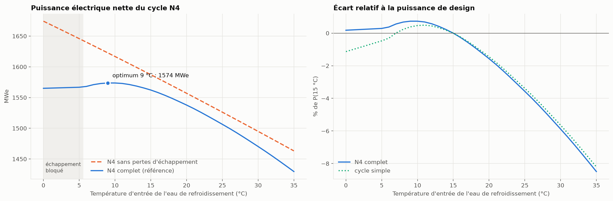
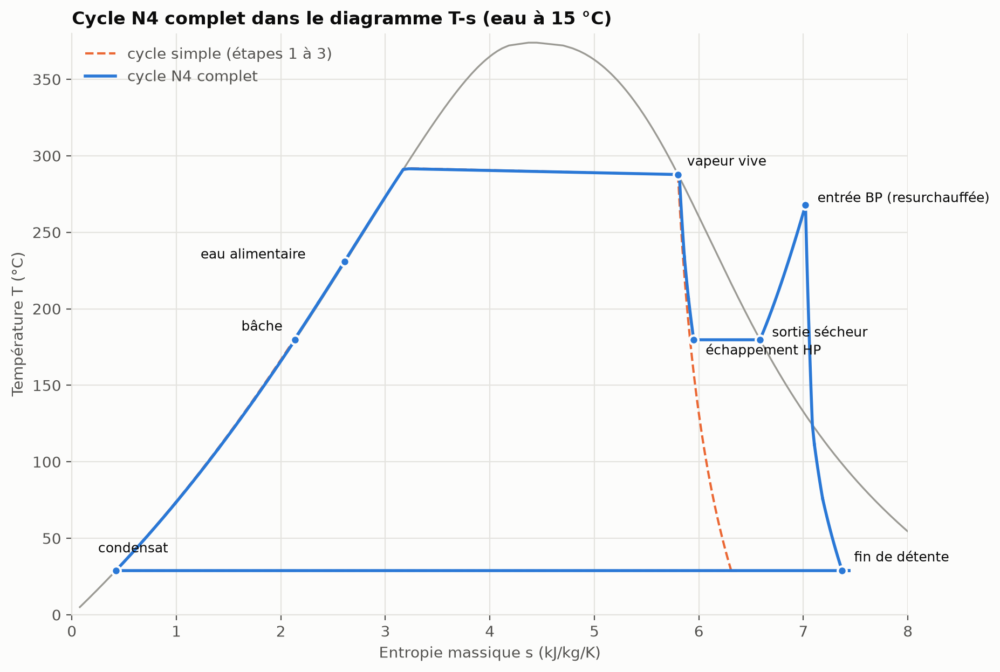
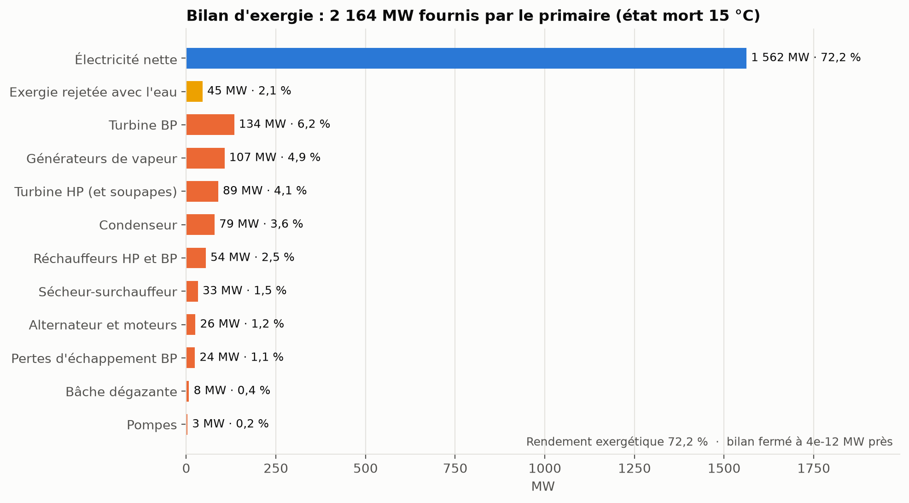
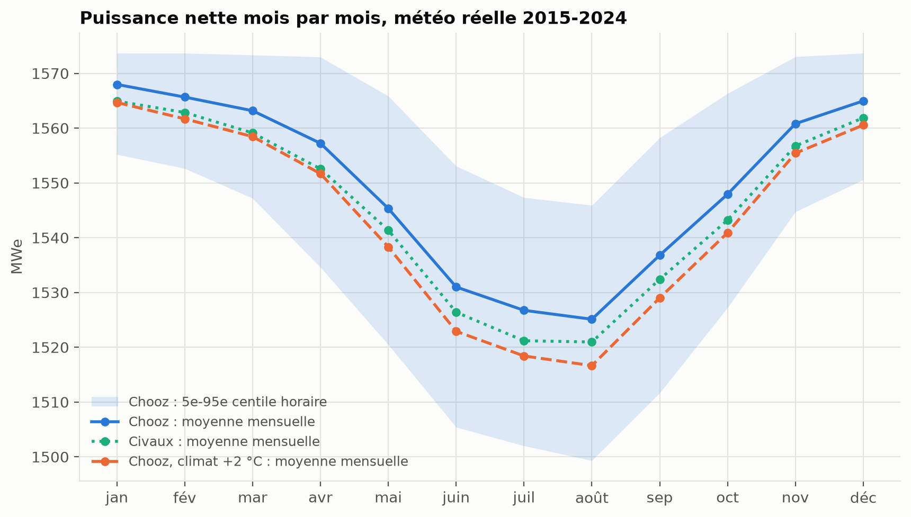
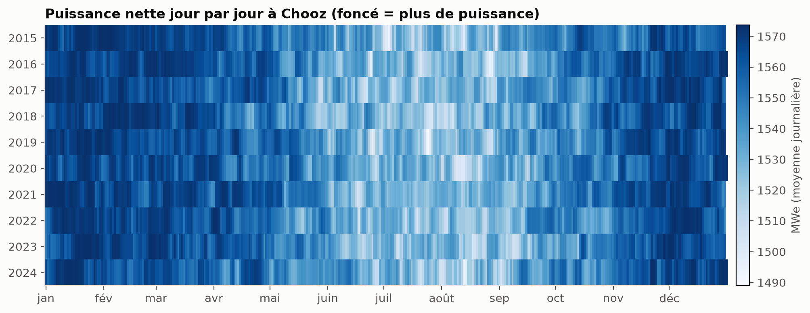
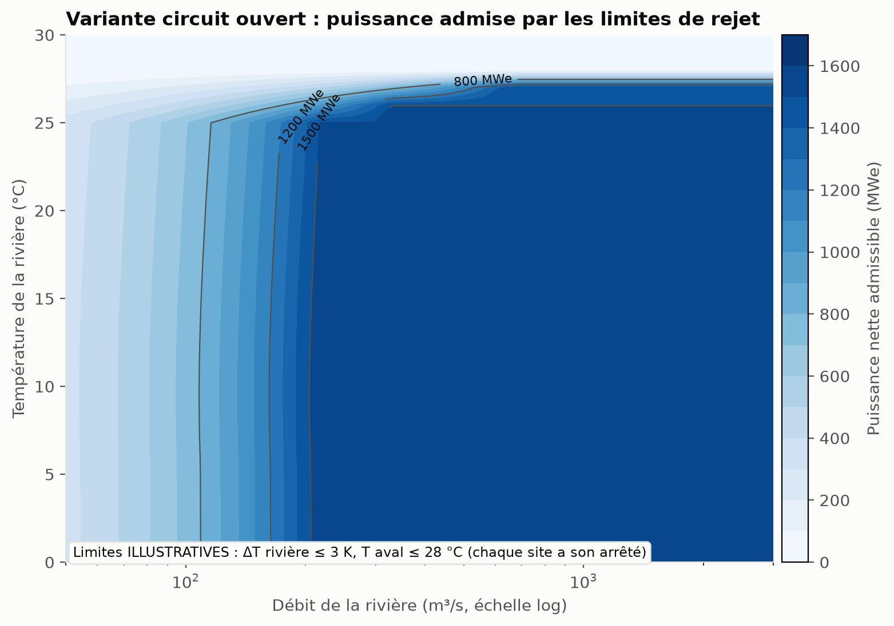
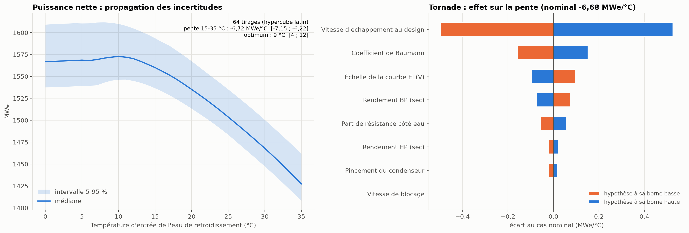

# Circuit secondaire d'un REP N4 avec TESPy

*Projet personnel de Maxime, élève ingénieur à l'IMT.*

Ce projet modélise le circuit eau-vapeur d'une tranche du palier N4 (Chooz B,
Civaux : 4 270 MWth). Il étudie l'effet de la **température de la source
froide** sur la puissance électrique, depuis un cycle de Rankine d'école
jusqu'à une étude sur dix ans de météo réelle.

| Étape | Contenu |
|---|---|
| 1 | Cycle de Rankine simple (GV, turbine, condenseur, pompe) |
| 2 | Étude offdesign : installation figée, température d'eau variable |
| 3 | Pertes d'échappement BP (Spencer-Cotton-Cannon), correction de UA du condenseur, vérification indépendante |
| 4 | **Cycle N4 complet** : turbine HP en 3 tronçons, sécheur-surchauffeur, turbine BP en 4 tronçons, 3 réchauffeurs BP, bâche, 2 réchauffeurs HP, primaire du GV, règle de Baumann |
| 5 | **Analyse exergétique** (Gouy-Stodola), composant par composant |
| 6 | **Tour aéroréfrigérante** à tirage naturel (Merkel) et **production horaire sur météo réelle** 2015-2024 (Chooz, Civaux), scénario climat +2 °C |
| 7 | **Limites réglementaires de rejet** (variante circuit ouvert) |
| 8 | **Incertitudes** : Monte-Carlo par hypercube latin et analyse en tornade |
| 9 | **Thermodynamique à la main** : sensibilité par Clapeyron et crédit de régénération, températures moyennes entropiques, diagrammes T-Q et Mollier, chacun confronté au modèle |

## Installation

```bash
py -3.12 -m venv .venv
.venv\Scripts\activate
pip install -r requirements.txt
pip install -e ".[dev]"
```

## Tout recalculer et visualiser

```bash
python scripts/telecharger_meteo.py   # météo ERA5 (déjà fournie dans data/)
python scripts/incertitudes.py        # Monte-Carlo, ~20 min sur 8 cœurs
python scripts/figures_rapport.py     # toutes les études et figures, ~8 min
python scripts/rapport_html.py        # rapport interactif
```

Ouvrir ensuite **`results/rapport.html`** dans un navigateur. C'est un rapport d'étude
interactif, au plan classique d'un rapport d'ingénierie :

- page de garde, résumé et mots-clés, nomenclature ;
- 1. Introduction · 2. Installation étudiée · 3. Modélisation (hypothèses H1 à H11, équations numérotées) · 4. Vérification et validation · 5. Résultats · 6. Analyse et discussion · 7. Conclusions et perspectives ;
- références ;
- annexes : A. états thermodynamiques, B. code source, C. journal de développement.

Les figures, tableaux et équations sont numérotés automatiquement, et les renvois du
texte pointent vers eux. Les figures restent interactives : curseur de température,
schéma cliquable, calculateur météo, limites de rejet réglables.

Avec `--cache`, `figures_rapport.py` réutilise les balayages déjà calculés.

Figures PNG (200 dpi) dans `results/` :

| Fichier | Contenu |
|---|---|
| `fig1_cycle_n4_Ts.png` | Cycle N4 et cycle simple dans le diagramme T-s |
| `fig2_bilan_sankey.png` | Bilan d'énergie au design |
| `fig3_puissance_n4.png` | Puissance en fonction de la température d'eau (N4, N4 sans pertes, cycle simple) |
| `fig4_pertes_echappement.png` | Courbe de pertes BP et points de fonctionnement |
| `fig5_exergie.png` | Destructions d'exergie par composant |
| `fig6_production_mensuelle.png` | Puissance mois par mois (Chooz, Civaux, climat +2 °C) |
| `fig7_carte_journaliere.png` | Puissance jour par jour à Chooz, 2015-2024 |
| `fig8_rejets.png` | Puissance admise par les limites de rejet (circuit ouvert) |
| `fig9_incertitudes.png` | Bande d'incertitude et tornade |

```bash
pytest     # 30 vérifications automatiques
```

## Arborescence

```
src/rep_secondaire/
    parametres.py           # ParametresRankine (cycle simple) et ParametresN4
    rankine_simple.py       # cycle simple (étapes 1 à 3)
    cycle_n4.py             # cycle N4 complet (TESPy), design + offdesign
    echappement.py          # pertes d'échappement BP (SCC, blocage)
    condenseur.py           # correction de UA avec la température d'eau
    exergie.py              # bilan d'exergie par composant
    tour.py                 # tour à tirage naturel (Merkel)
    annuel.py               # chaîne météo -> tour -> centrale, agrégations
    rejets.py               # limites de rejet thermique
    incertitudes.py         # Monte-Carlo et tornade
    etude_source_froide.py  # balayage en température (cycle simple ou N4)
    diagrammes.py, figures.py, figures_n4.py
scripts/                    # points d'entrée (voir plus haut)
data/meteo_*.csv            # météo horaire ERA5 2015-2024 (Open-Meteo, CC BY 4.0)
rapport/modele_rapport.html # gabarit du rapport interactif
tests/                      # vérifications (pytest)
```

## Le cycle N4 modélisé

```
Primaire ─► [GV] ─► vapeur vive ─┬─► soupapes ─► HP1 ─► HP2 ─► HP3 ─► [Sécheur] ─► [Surchauffeur] ─► BP1 ─► BP2 ─► BP3 ─► BP4 ─► [Pertes éch.] ─► [Condenseur] ◄─► Tour
                                 └──────────────────────────────────────────────────────┘ (vapeur de surchauffe)
Poste d'eau : Condenseur ─► CEX ─► RBP1 ─► RBP2 ─► RBP3 ─► Bâche ─► Pompe alim. ─► RHP1 ─► RHP2 ─► GV
Soutirages : HP1→RHP2 (30 bar), HP2→RHP1 (18 bar), HP3→bâche + sécheur (10 bar), BP1→RBP3 (4 bar), BP2→RBP2 (1,5 bar), BP3→RBP1 (0,4 bar)
Purges en cascade : surchauffeur → RHP2 → RHP1 → bâche ; RBP3 → RBP2 → RBP1 → condenseur
```

Les choix de modélisation qui comptent :

- **GV avec son primaire.** Au design, on impose 72 bar. En offdesign, la
  pression résulte du UA du GV, à débit primaire et puissance fixés. Elle reste
  à 72,0 bar sur toute la plage, ce qui valide l'hypothèse des étapes 1 à 3.
- **Turbines.** Les rendements « vapeur sèche » (HP 0,89, BP 0,91) sont pénalisés
  par la règle de Baumann : η = η_sec·(1 − y_moy). Les tronçons humides tombent
  à 0,77-0,85. En offdesign, la loi du cône de Stodola s'applique à chaque
  tronçon, et la perte de charge des soupapes HP devient libre (vannes de réglage).
- **Échangeurs.** Écart terminal de 3 K au design, puis UA_char en offdesign.
  La bâche est un réchauffeur à mélange avec sortie en liquide saturé.
- **Condenseur et échappement.** Ce sont les modèles des étapes précédentes :
  UA corrigé selon la température d'eau, pertes SCC avec blocage.

### Validation contre les données publiques

| Grandeur | Modèle | Publié (ordre de grandeur) | Écart |
|---|---|---|---|
| Puissance électrique brute | 1 589 MWe | ≈ 1 560 MWe | +1,9 % |
| Eau alimentaire | 230,9 °C | ≈ 230 °C | +0,4 % |
| Débit de vapeur | 2 406 kg/s | ≈ 2 400 kg/s | +0,2 % |
| Pression vapeur | 72,0 bar | ≈ 72 bar | — |

Le modèle **n'est pas calé** : l'écart de +1,9 % vient de ce qu'il ignore (fuites
aux garnitures, purges des GV, vapeur auxiliaire, pertes de charge des soutirages).

## Résultats

### Effet de la température d'eau (cycle N4)

- **Au design (eau à 15 °C) :** 1 589 MWe bruts, 1 562 MWe nets, rendement du cycle 37,2 %.
- **Optimum :** 1 574 MWe nets pour une eau à 9 °C. En dessous de 6 °C,
  l'échappement BP est bloqué.
- **Au-dessus de 15 °C :** −6,7 MWe/°C (−0,43 %/°C), contre −5,6 MWe/°C pour le cycle simple.
- **Dans la zone bloquée,** la puissance reste plate. Dans le cycle simple, elle
  baissait, parce que le condensat froid n'était pas réchauffé par des soutirages.




### Thermodynamique à la main

Chaque résultat important est redémontré sans le modèle, puis confronté au calcul
numérique (`analyse_thermo.py`, `tests/test_analyse_thermo.py`).

**Sensibilité au condenseur.** La relation de Gibbs à entropie constante (dh = v dp)
et la relation de Clapeyron donnent :

    dW/dT_c ≈ −η · ṁ · x · h_fg / T_c = −η · Q_lat / T_c ≈ −6,9 MW/K

Le cycle à soutirages ajoute un crédit de régénération (+0,7 MW/K) : un condensat plus
chaud demande moins de soutirage au réchauffeur RBP1. On obtient −6,16 MW/K à la main,
contre −6,05 MW/K pour le modèle sans pertes d'échappement, soit 1,8 % d'écart. Près du
design, la baisse des pertes d'échappement ajoute encore +1,1 MW/K.

**Gain du réchauffage.** La température moyenne entropique d'apport de chaleur,
T̄ = Δh/Δs, passe de 218 °C (cycle simple) à 283 °C (N4). Le rendement endoréversible
passe donc de 38,5 % à 45,7 %. La fraction de ce rendement idéal atteinte reste
d'environ 82 % dans les deux cas : tout le gain vient de T̄.

**Pincements.** Le pincement vaut 7,6 K dans le GV, au début de l'ébullition, et 4 K au
condenseur. La température de condensation suit l'eau de refroidissement à 1,007 K/K.

### Exergie

Le primaire fournit 2 164 MW d'exergie (état mort : 15 °C). Le rendement
exergétique vaut 72 %. Les plus grosses destructions ont lieu dans la **turbine
BP** (134 MW, à cause de l'humidité), puis dans le **GV** (107 MW, écart de
température primaire-secondaire) et la **turbine HP** (89 MW). Le condenseur
rejette 2 600 MW de chaleur, mais ne détruit que 79 MW d'exergie : cette
chaleur est à 29 °C, presque à la température ambiante.



### Météo réelle, tour aéroréfrigérante, climat

La chaîne de calcul est la suivante : air (ERA5 horaire) → tour à tirage naturel (Merkel, Le = 1,
tirage (L/G)²·Δρ = cte) → eau au condenseur → puissance (balayage offdesign N4).
On suppose le réacteur à pleine puissance toutes les heures.

| | Chooz | Civaux |
|---|---|---|
| Production nette moyenne | 13,58 TWh/an | 13,55 TWh/an |
| Puissance moyenne en janvier / en août | 1 568 / 1 525 MWe | 1 565 / 1 521 MWe |
| Climat +2 °C (humidité relative constante) | −54 GWh/an (−0,4 %) | −58 GWh/an (−0,4 %) |




### Limites de rejet (variante circuit ouvert)

Avec une tour, la chaleur part dans l'air. Si la tranche était refroidie
directement par la rivière, ses ≈ 2 600 MW rejetés limiteraient la puissance dès
que la rivière est chaude ou à faible débit. Les limites utilisées sont
**illustratives** (échauffement ≤ 3 K, aval ≤ 28 °C), car chaque site a son
propre arrêté.



### Incertitudes

Huit hypothèses incertaines ont été tirées 64 fois par hypercube latin, et chaque
tirage a été recalculé complètement (design et balayage, 0 échec) :
- rendements HP et BP ;
- coefficient de Baumann ;
- vitesses d'échappement de design et de blocage ;
- échelle de la courbe de pertes ;
- part de résistance côté eau ;
- pincement.

Une analyse en tornade complète l'étude : chaque hypothèse est mise à ses bornes, une à la fois.

| Grandeur | Médiane | Intervalle 5-95 % |
|---|---|---|
| Pente au-dessus de 15 °C | −6,72 MWe/°C | −7,15 à −6,22 |
| Température d'optimum | 9 °C | 4 à 12 °C |
| Puissance nette au design | 1 560 MWe | 1 537 à 1 594 |

- **La sensibilité au-dessus de 15 °C est robuste.**
- **La position de l'optimum ne l'est pas.** Elle dépend surtout de la vitesse
  d'échappement au design, c'est-à-dire de la taille de la dernière ailette BP.
- **La vitesse de blocage n'influe pas sur la pente au-dessus de 15 °C**, ce qui
  est attendu : l'écoulement n'y est jamais bloqué.



## Vérifications (`pytest`)

- **Cycle simple :** point de design recalculé indépendamment (CoolProp seul),
  écart inférieur à 10⁻⁵.
- **Cycle N4 :**
  - bilans d'énergie et de matière fermés ;
  - aucune création d'entropie négative, composant par composant ;
  - bilan d'exergie fermé à 10⁻⁶ MW ;
  - ordres de grandeur N4 retrouvés ;
  - l'offdesign à 15 °C redonne le design, et la pression GV calculée reste à 72 ± 0,5 bar.
- **Tour :**
  - Tchebychev 4 points contre une intégration numérique fine : écart inférieur à 1 % ;
  - point de conception retrouvé ;
  - eau jamais sous la température humide.
- **Rejets :** comportements limites vérifiés (grand fleuve, rivière déjà trop chaude).

## Transparence

Un assistant d'IA a servi d'aide à la programmation. Les choix de modélisation, les
vérifications et l'interprétation sont détaillés dans l'onglet Démarche du rapport, et
chacun est couvert par un test. `docs/preparation_entretien.md` rassemble les questions
techniques à maîtriser pour présenter le projet.

## Limites

- **Courbe d'échappement BP générique** : c'est l'hypothèse la plus influente sur l'optimum.
- **Tour simplifiée** : pas de vent, pas de recirculation de panache, pas d'antigel
  modélisé (l'eau froide est bornée à la plage 0-35 °C).
- **Production annuelle** : c'est un maximum théorique, sans arrêts ni suivi de charge.
- **Limites de rejet** : illustratives, et calculées avec un rendement supposé constant à charge partielle.
