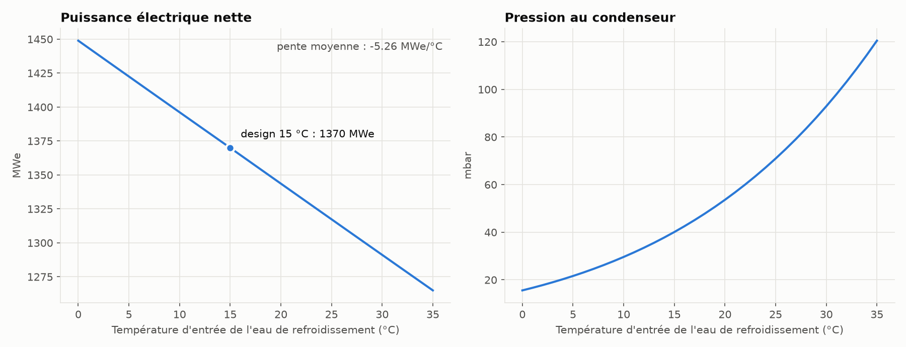

# Circuit secondaire d'un REP N4 avec TESPy

Le but du projet est de modéliser le circuit secondaire (eau-vapeur) d'un réacteur
à eau pressurisée du palier N4 (Chooz B, Civaux : 4 270 MWth) et d'étudier
l'effet de la **température de l'eau de refroidissement** sur la puissance électrique.

- **Étape 1** : cycle de Rankine simple, sans soutirages ni sécheur-surchauffeur (MSR).
- **Étape 2 (actuelle)** : étude offdesign de la sensibilité à la température de l'eau froide.

## Installation

```bash
py -3.12 -m venv .venv
.venv\Scripts\activate
pip install -r requirements.txt
pip install -e ".[dev]"
```

`requirements.txt` fige les versions exactes testées (TESPy 0.12.0, CoolProp 8.0).
`pyproject.toml` déclare le paquet `rep_secondaire` et ses dépendances minimales.

## Utilisation

```bash
python scripts/run_rankine_simple.py      # point de dimensionnement
python scripts/etude_source_froide.py     # balayage 0-35 °C -> results/
pytest
```

## Arborescence

```
src/rep_secondaire/
    parametres.py       # tous les paramètres de conception (dataclass)
    rankine_simple.py   # construction et résolution du réseau TESPy (design + offdesign)
    etude_source_froide.py  # balayage en température de l'eau de refroidissement
scripts/
    run_rankine_simple.py  # affiche états, bilan et rendements
    etude_source_froide.py # CSV + figure de l'étude de sensibilité
tests/                  # contrôles : bilan d'énergie, ordres de grandeur, tendance
results/                # sorties (CSV, figures), non versionnées
```

## Le modèle

```
 (0) ──► [GV] ──(1)──► [Turbine] ──(2)──► [Condenseur] ──(3)──► [Pompe] ──(4)──► [Fermeture] ──► (0)
                                               ▲   │
                         eau froide (11) ──────┘   └──── (12) rejet
```

| Composant | Classe TESPy | Ce qu'on impose |
|---|---|---|
| Générateur de vapeur (4 GV agrégés) | `SimpleHeatExchanger` | Q = 4 270 MW, Δp = 8 bar ; sortie : 72 bar, x = 1 |
| Turbine (HP + BP en un seul corps) | `Turbine` | η_is = 0,85 |
| Condenseur | `Condenser` | pincement T_sat − T_sortie eau = 4 K, Δp = 0 |
| Eau de refroidissement | `Source` / `Sink` | entrée 15 °C, sortie 25 °C |
| Pompe alimentaire | `Pump` | η_is = 0,80 |
| Fermeture de cycle | `CycleCloser` | (outil numérique, voir plus bas) |

Le solveur calcule le reste : le débit de vapeur (pour absorber 4 270 MW), la
pression au condenseur (via le pincement), le titre en sortie turbine, le débit
d'eau de refroidissement, et toutes les puissances.

### Hypothèses

- **Puissance au secondaire égale à la puissance du réacteur.** On néglige les
  ~20 MW apportés par les pompes primaires et les pertes thermiques.
- **Vapeur saturée sèche à 72 bar.** En réalité le titre en sortie GV est d'environ
  0,9975. Les pertes de charge de la ligne vapeur ne sont pas modélisées.
- **Δp de 8 bar côté alimentation.** Ce chiffre regroupe les pertes de la ligne
  d'eau alimentaire et du GV. La pompe refoule donc à 80 bar.
- **Une seule détente, η_is = 0,85.** Sans MSR, la vapeur sort de la turbine à
  x ≈ 0,73, soit environ 27 % d'humidité. Une vraie turbine ne le supporterait pas
  (érosion des aubages, et environ −1 % de rendement par % d'humidité selon la
  règle de Baumann). Le MSR sert justement à corriger ça.
- **Condenseur dimensionné par son pincement.** Avec 15 °C + 10 K + 4 K, on obtient
  T_sat = 29 °C, soit p ≈ 40 mbar, ce qui correspond à l'ordre de grandeur N4.
  Le sous-refroidissement est nul (liquide saturé en sortie).
- **Rendement mécanique × alternateur = 0,985, moteur de pompe = 0,95.** On suppose
  la pompe entraînée électriquement. Sur N4, ce sont des turbopompes. Les
  auxiliaires ne sont pas comptés.
- **Calcul en mode *design*.** On fixe ΔT et le pincement, et le débit d'eau de
  refroidissement en découle. L'étude de sensibilité, elle, se fait en
  *offdesign* (voir plus bas).

### Rôle du `CycleCloser`

TESPy résout un système d'équations. Dans une boucle fermée, la conservation de
la masse et de l'énergie rend une équation redondante. Le `CycleCloser` coupe
numériquement la boucle pour supprimer cette redondance. Il n'a aucun sens
physique.

## Résultats (étape 1)

| Grandeur | Valeur |
|---|---|
| Débit vapeur | 1 618 kg/s |
| Pression / température condenseur | 40,1 mbar / 29,0 °C |
| Titre sortie turbine | 0,731 |
| Puissance turbine | 1 408 MW |
| Puissance pompe | 16 MW |
| Chaleur rejetée | 2 878 MW |
| Puissance électrique nette | 1 370 MWe |
| **Rendement du cycle** | **32,6 %** |
| Rendement net électrique | 32,1 % |
| Rendement de Carnot (288 °C / 15 °C) | 48,6 % |

Le N4 réel atteint environ 34-35 % brut. On s'attend à combler l'écart avec les
soutirages (eau alimentaire réchauffée à ~230 °C) et le MSR.

## Étude offdesign : effet de la température de l'eau de refroidissement

On fait d'abord le dimensionnement à 15 °C, puis on fige l'installation. On fait
ensuite varier la seule température d'entrée de l'eau, de 0 à 35 °C.

| Grandeur | Design (15 °C) | Offdesign |
|---|---|---|
| Condenseur | pincement 4 K | UA fixé (corrigé selon les débits par `UA_char`) |
| Eau de refroidissement | ΔT = 10 K | débit fixé (pompes de circulation à débit constant) |
| Turbine | η_is = 0,85 | η_is selon le débit (`eta_s_char`) |
| Pompe | η_is = 0,80 | η_is selon le débit (`eta_s_char`) |
| Puissance réacteur, p vapeur | 4 270 MW, 72 bar | inchangées |

Pourquoi la pression vapeur reste fixée : à puissance nominale, la régulation du
primaire maintient la température moyenne de l'eau. La température de
saturation au GV, donc sa pression, ne bouge presque pas. Pour cette raison, la
loi du cône de Stodola n'est pas activée.

Pour faire converger le solveur de Newton, on se déplace par pas d'au plus 1 K
à partir du point de dimensionnement. Chaque calcul part de la solution
précédente.

### Résultats

| T eau (°C) | p cond (mbar) | T rejet (°C) | P nette (MWe) | η net |
|---|---|---|---|---|
| 0 | 15,6 | 9,7 | 1 449 | 33,9 % |
| 5 | 21,6 | 14,8 | 1 423 | 33,3 % |
| 10 | 29,6 | 19,9 | 1 396 | 32,7 % |
| **15** | **40,1** | **25,0** | **1 370** | **32,1 %** |
| 20 | 53,6 | 30,1 | 1 344 | 31,5 % |
| 25 | 71,0 | 35,2 | 1 317 | 30,9 % |
| 30 | 92,9 | 40,3 | 1 291 | 30,2 % |
| 35 | 120,5 | 45,4 | 1 265 | 29,6 % |

**Sensibilité : −5,3 MWe/°C, soit −0,38 %/°C.** Entre 0 °C et 35 °C, on perd 184 MWe.



Lecture physique : quand l'eau est plus chaude, la vapeur condense plus chaud
et la pression au condenseur augmente. La détente dans la turbine est donc plus
courte et produit moins de travail. La pression de saturation croît à peu près
exponentiellement avec la température. La perte de puissance, elle, reste
presque linéaire, car le travail récupéré dépend de la température de
condensation et non de la pression.

### Limites

- **Pas de pertes d'échappement BP.** Quand la pression au condenseur baisse,
  la vapeur sort de la turbine plus vite, et l'énergie cinétique perdue
  augmente. En dessous de 25-30 mbar, la section de sortie peut même se saturer
  (blocage sonique). Le modèle surestime donc le gain en eau froide : une vraie
  courbe de puissance s'aplatit à basse température.
- **Rejet thermique non contraint.** À 35 °C, l'eau ressort à 45 °C. Les
  arrêtés de rejet imposent des limites (température aval, échauffement), et
  ce sont elles qui provoquent les baisses de production en été, plus que le
  rendement lui-même.
- **Caractéristiques par défaut de TESPy.** Les lois `UA_char` et `eta_s_char`
  ne sont pas calées sur des données constructeur.
- Le cycle reste simple : sans MSR ni soutirages, la sensibilité réelle sera
  différente.

## Étapes suivantes

1. Modèle de pertes d'échappement BP (courbe de perte selon la vitesse de sortie).
2. Sécheur-surchauffeur entre les corps HP et BP.
3. Soutirages et réchauffeurs BP/HP, bâche alimentaire.
